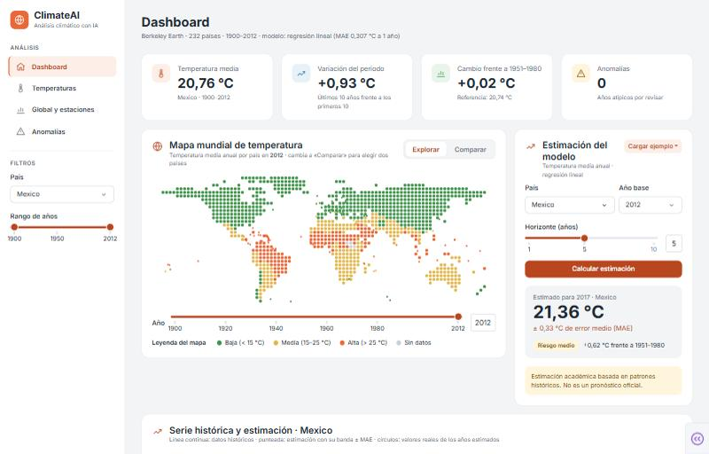
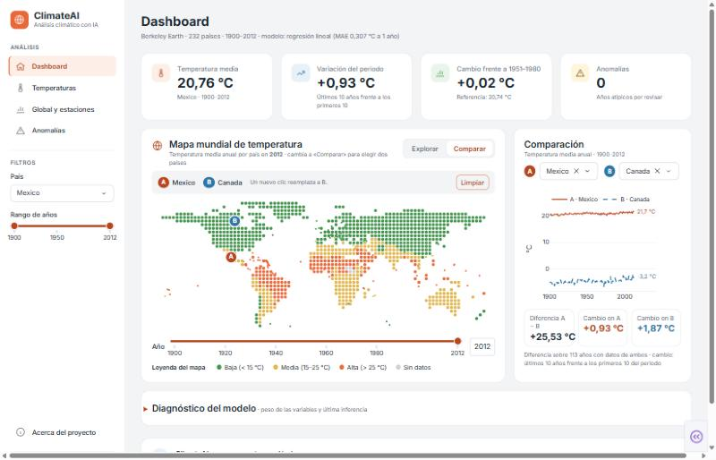
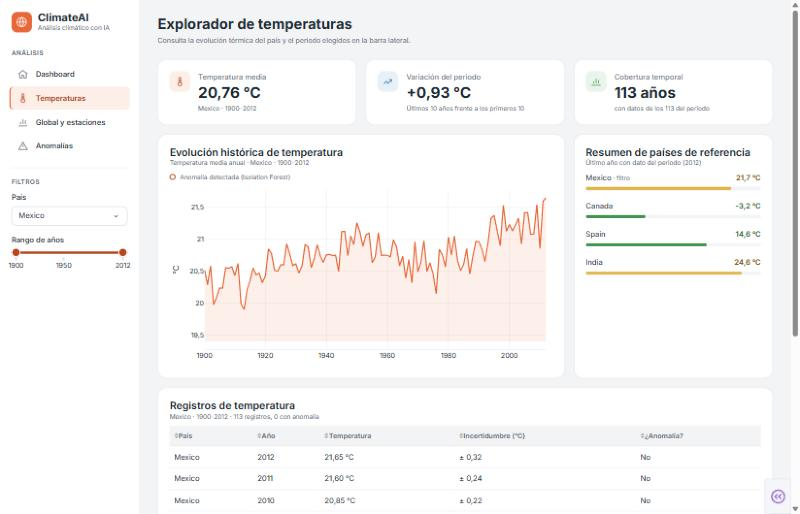
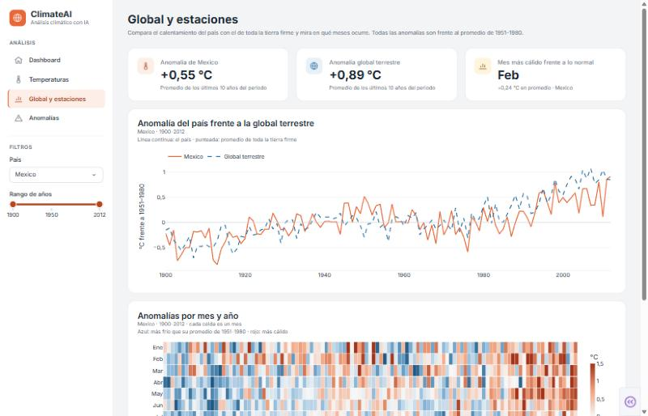
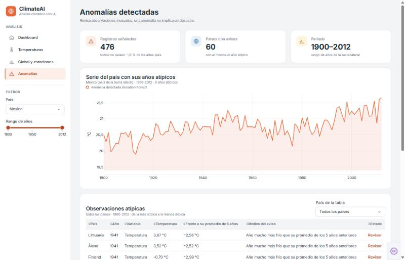
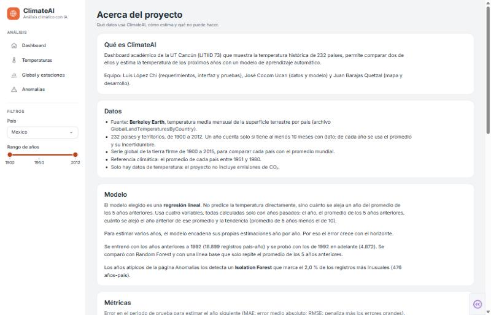

# ClimateAI · dashboard climático

Dashboard web académico (UT Cancún, LITIID 73) que muestra la temperatura histórica de 232 países, compara dos países y estima la temperatura de los próximos años con un modelo de aprendizaje automático. Usa solo datos de temperatura de Berkeley Earth (1900–2012).

**Equipo:** Luis López Chi (requerimientos, interfaz y pruebas) · José Cocom Ucan (datos y modelo) · Juan Barajas Quetzal (mapa y desarrollo).

> Las estimaciones son académicas, basadas en patrones históricos. No son pronósticos oficiales.

## Capturas

**Dashboard:** KPIs según los filtros, mapa mundial por año, estimación del modelo con su margen de error y evolución de la temperatura. En el filtro «País» se puede elegir «Promedio global (tierra firme)» para ver cómo ha cambiado la temperatura en todo el mundo.



**Dashboard en modo Comparar:** se eligen dos países en el mapa (A y B) y el panel muestra sus series, la diferencia y el cambio de cada uno.



**Temperaturas:** evolución del país, países de referencia y tabla de registros con anomalías.



**Global y estaciones:** anomalía del país frente a la global terrestre y mapa de calor por mes y año.



**Anomalías:** años atípicos detectados con Isolation Forest y cómo interpretarlos.



**Acerca del proyecto:** datos, modelo, métricas, limitaciones y licencia.



## Instalación paso a paso en Windows

Necesitas **Python 3.11 o superior** (probado con 3.14) y unos 300 MB libres. Los comandos son para **PowerShell**.

1. **Instala Python** desde [python.org](https://www.python.org/downloads/). En el instalador marca «Add python.exe to PATH». Comprueba en una terminal nueva:

   ```powershell
   py --version
   ```

2. **Abre la carpeta del proyecto** en PowerShell (la que contiene este README):

   ```powershell
   cd "C:\ruta\a\ClimateAI\climateai_modelo"
   ```

3. **Crea y activa un entorno virtual:**

   ```powershell
   py -m venv .venv
   .\.venv\Scripts\Activate.ps1
   ```

   Si PowerShell dice que la ejecución de scripts está deshabilitada, permítela solo para esta ventana y vuelve a activar:

   ```powershell
   Set-ExecutionPolicy -Scope Process -ExecutionPolicy Bypass
   .\.venv\Scripts\Activate.ps1
   ```

   Al activarse, la línea de comandos empieza con `(.venv)`.

4. **Instala las dependencias:**

   ```powershell
   pip install -r requirements.txt
   ```

5. **Abre la app:**

   ```powershell
   python app/app.py
   ```

   Abre http://127.0.0.1:8050 en el navegador (Chrome, Edge o Firefox). Para detenerla, pulsa `Ctrl + C` en la terminal.

Los datos procesados y el modelo entrenado ya vienen en `data/processed/` y `modelo/`, así que no hace falta preparar nada más para usar la app.

## Volver a generar los datos y el modelo (opcional)

Solo si cambian los CSV originales o se quiere reproducir todo desde cero. Con el entorno virtual activado:

1. **Descomprime los datos originales** en `data/raw/` (esa carpeta no se sube al repositorio):

   ```powershell
   Expand-Archive -Path "..\Global Land Temperatures.zip" -DestinationPath data\raw
   ```

2. **Prepara los datos** (limpia los CSV y crea los archivos de `data/processed/`):

   ```powershell
   python preparar_datos.py "data/raw/Global Land Temperatures" data/processed
   ```

3. **Entrena y compara los modelos** (guarda el elegido en `modelo/modelo_clima.joblib`, las métricas y las anomalías):

   ```powershell
   python modelo/entrenar.py data/processed
   ```

4. **Mide el error por horizonte** (1 a 10 años):

   ```powershell
   python modelo/evaluar_horizonte.py
   ```

5. **Prueba el modelo** con algunos casos:

   ```powershell
   python probar_predecir.py
   ```

   Si los acentos salen rotos en la terminal, ejecuta antes `$env:PYTHONIOENCODING = "utf-8"`.

6. **Tabla de países a ISO3 y puntos del mapa.** El segundo script usa geopandas y descarga los mapas de Natural Earth, así que necesita internet la primera vez:

   ```powershell
   python scripts/generar_paises_iso3.py
   pip install -r requirements-scripts.txt
   python scripts/generar_puntos_mapa.py
   ```

Archivos que se generan en `data/processed/`:

| Archivo | Contenido |
| --- | --- |
| `clima_pais_anio.csv` | Una fila por país y año (232 países, 1900–2012) |
| `temperatura_pais_mes.csv` | Datos mensuales, para el mapa de calor |
| `global_anio.csv` | Temperatura global terrestre anual (1900–2015) |
| `anomalias.csv` | Años atípicos detectados con Isolation Forest (2 %) |
| `metricas.json`, `mae_por_horizonte.json` | Resultados de la evaluación del modelo |
| `paises_iso3.csv` | Código ISO3 de cada país |
| `puntos_mapa.csv` | Puntos del mapa (cuadrícula cada 4° y un punto por país pequeño) |

## Pruebas

```powershell
pytest -q
```

Revisa los datos, el modelo, cada página, la selección A/B, el contraste de colores y que ningún callback tarde más de 3 s. La lista de verificación manual (navegadores, usabilidad y contraste) está en [`tests/CHECKLIST.md`](tests/CHECKLIST.md).

## Estructura

```
climateai_modelo/
├── app/
│   ├── app.py              # punto de entrada (Dash con varias páginas)
│   ├── datos.py            # lee data/processed una sola vez
│   ├── componentes/        # barra lateral, tarjetas, mapa, estimación, comparación…
│   └── pages/              # Dashboard, Temperaturas, Global y estaciones, Anomalías, Acerca
├── assets/                 # estilos, íconos y efecto «lupa» del mapa
├── data/processed/         # datos listos para la app
├── modelo/                 # entrenamiento, predecir() y modelo entrenado
├── scripts/                # tabla ISO3 y puntos del mapa
├── tests/                  # pruebas automáticas y lista de verificación manual
├── preparar_datos.py
├── requirements.txt        # dependencias de la app
└── requirements-scripts.txt  # geopandas, solo para generar los puntos del mapa
```

Las reglas de desarrollo están en [`CLAUDE.md`](CLAUDE.md) y el plan de trabajo en [`PLAN.md`](PLAN.md).

## Problemas comunes

- **«py no se reconoce como un comando»:** Python no quedó en el PATH. Reinstálalo marcando «Add python.exe to PATH» y abre una terminal nueva.
- **La app dice que el puerto 8050 está ocupado:** ya hay otra copia corriendo. Ciérrala con `Ctrl + C` en su terminal.
- **Faltan módulos (`ModuleNotFoundError`):** el entorno virtual no está activado. Actívalo (paso 3) y vuelve a ejecutar.

## Datos y licencia

Datos de temperatura: © [Berkeley Earth](https://berkeleyearth.org/data/), con licencia [Creative Commons BY-NC 4.0](https://creativecommons.org/licenses/by-nc/4.0/) (atribución, uso no comercial). Contornos para los puntos del mapa: [Natural Earth](https://www.naturalearthdata.com/) (dominio público). Las limitaciones del modelo se explican en la página «Acerca del proyecto».
